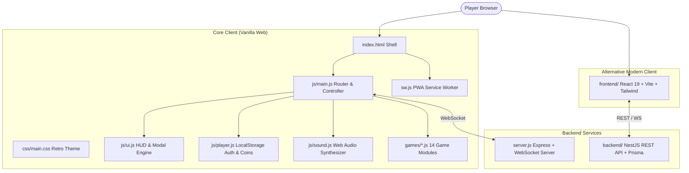

# 🕹️ Retro Game Hub

<div align="center">


**A complete, browser-native retro gaming arcade engineered from scratch.**  
Bringing 14 nostalgic notebook, puzzle, and arcade classics into a single unified web platform with persistent player profiles, coin rewards, procedural 8-bit audio, and real-time multiplayer support.

[Live Demo](#how-to-run) • [Game Catalog](#-game-catalog-14-games) • [Architecture](#-system-architecture) • [Academic PBL Details](#-project-based-learning-pbl-academic-overview) • [Ending Statement](#-ending-statement)

</div>

---

## 📖 Executive Summary

**Retro Game Hub** is a multi-game platform inspired by the classic notebook and tabletop games traditionally played by students during school and college breaks. The project revitalizes these timeless pastimes into a responsive, zero-dependency browser arcade.

Designed with a dual-frontend architecture:
1. **Core Vanilla Arcade**: Built with pure HTML5, CSS3, and modern Vanilla JavaScript with zero external frameworks, featuring custom Web Audio API synthesis and full PWA offline capabilities.
2. **Modern React Frontend**: A modern client built with React 19, TypeScript, Vite, Tailwind CSS v4, and Framer Motion.
3. **Multiplayer Server**: A Node.js + Express WebSocket hub facilitating 2-player peer matchmaking and live room codes.
4. **Enterprise Backend**: A NestJS + Prisma REST service for scalable cloud profiles and centralized leaderboards.

---

## 🎮 Game Catalog (14 Games)

Every game includes custom graphics, responsive input handling (mouse, touch, keyboard), procedural sound effects, and persistent coin reward payouts.

| Game | Category | Mode | Description | Reward |
|:---|:---:|:---:|:---|:---:|
| **Dots & Boxes** | Strategy | AI / 2P / Online | Tactical territory capture on grid borders with box-completion mechanics | 🪙 +15 coins |
| **Tic-Tac-Toe** | Board | AI / 2P / Online | Classic 3×3 tactical grid with Minimax AI and real-time room battles | 🪙 +10 coins |
| **Snakes & Ladders** | Board | AI / 2P | Interactive board game with dynamic dice physics, snakes, and ladders | 🪙 +20 coins |
| **Battleship** | Strategy | AI / 2P | Naval radar warfare on 10×10 grids with hidden fleet deployments | 🪙 +25 coins |
| **Connect Four** | Strategy | AI / 2P | Gravity-based 7×6 column disc drop with heuristic AI analysis | 🪙 +12 coins |
| **Hangman** | Word | Solo | Lexical deduction puzzle featuring multi-category dictionaries & retro stickman | 🪙 +14 coins |
| **Memory Match** | Puzzle | Solo / AI | Card-flipping cognitive challenge with paired 8-bit retro icons | 🪙 +16 coins |
| **Tetris** | Arcade | Solo | Authentic tetromino matrix stacking with line-clearing score cascades | 🪙 +20 coins |
| **Pong** | Arcade | Solo vs AI | High-speed 60 FPS paddle rally with ball acceleration and adaptive AI | 🪙 +12 coins |
| **Snake** | Arcade | Solo | Classic arcade serpentine slither with fruit feeding and wall wrapping | 🪙 +15 coins |
| **2048** | Puzzle | Solo | Sliding block tile arithmetic puzzle striving for the legendary 2048 tile | 🪙 +25 coins |
| **Breakout** | Arcade | Solo | Brick-smashing paddle arcade with ball rebounds and multi-tier walls | 🪙 +20 coins |
| **Minesweeper** | Puzzle | Solo | Classic logic deduction with safe tile cascades, flags, and danger timers | 🪙 +18 coins |
| **Simon Says** | Reflex | Solo | Audio-visual pattern recognition with progressive flashing chime sequences | 🪙 +20 coins |

---

## 🚀 Key Features & Technical Highlights

### 1. 📴 Offline-Ready Progressive Web App (PWA)
- Full service worker caching (`sw.js`) and web app manifest (`manifest.json`).
- Installable on mobile and desktop devices as a standalone native-feeling application.
- Works 100% offline without requiring internet connectivity for single-player and AI games.

### 2. 🎵 Procedural Web Audio Engine (`js/sound.js`)
- Zero external MP3/WAV audio assets—everything is generated dynamically in code using the browser's native **Web Audio API**.
- Custom synthesizers: square waves, sine sweeps, noise bursts, and triangle waves for punches, laser shots, blips, coin rewards, and retro background chiptune tracks.
- Dedicated volume controls and instantaneous sound toggling.

### 3. 👤 Player Database & Progression (`js/player.js`)
- Client-side persistence using browser `localStorage` with JSON serialization.
- PIN-based authentication with simple hashing, custom avatar selection, and guest mode.
- Progression tracking: coin balance, current streaks, win counters across all 14 games, and multi-category global leaderboards.

### 4. 🌐 Real-Time Multiplayer Networking (`server.js`)
- Lightweight WebSocket server built on Express and `ws`.
- Room-based architecture: Host a match to generate a 6-character room code, share with a friend, and play in real time with low latency.
- Auto-reconnection, disconnect handling, and turn synchronization.

### 5. 🎨 Retro CRT Aesthetic & Design System (`css/main.css`)
- Handcrafted pixel-art UI with retro glowing CRT scanline shaders, phosphor green/neon accents, and customized retro typography (`VT323`, `Press Start 2P`).
- Responsive layout designed to adapt fluidly across mobile phones, tablets, and ultrawide desktop monitors.

---

## 🛠️ System Architecture



---

## 📂 Project Directory Structure

```plaintext
retro-game-hub/
├── index.html                   # Main single-page application shell
├── manifest.json                # PWA manifest configuration
├── sw.js                        # Service worker for offline caching
├── server.js                    # Node.js WebSocket & static file server
├── package.json                 # Server metadata & dependencies
│
├── css/
│   └── main.css                 # Global retro styles, CRT effects & themes
│
├── js/
│   ├── main.js                  # Main controller, router & event coordinator
│   ├── ui.js                    # Modal dialogs, HUD elements & screen switches
│   ├── player.js                # Profile database, PIN hashing & coins
│   ├── sound.js                 # Procedural Web Audio API sound generator
│   └── pwa.js                   # PWA registration & install prompts
│
├── games/                       # Vanilla JavaScript Game Implementations
│   ├── tictactoe.js             # Tic-Tac-Toe with Minimax AI & multiplayer
│   ├── dots.js                  # Dots & Boxes grid algorithm
│   ├── snl.js                   # Snakes & Ladders game board & dice engine
│   ├── battleship.js            # Battleship radar grid & fleet logic
│   ├── connectfour.js           # Connect Four drop physics & AI
│   ├── hangman.js               # Hangman dictionary & canvas rendering
│   ├── memorymatch.js           # Memory Match card pair engine
│   ├── tetris.js                # Tetris matrix & block rotation engine
│   ├── pong.js                  # 60 FPS canvas Pong physics & AI paddle
│   ├── snake.js                 # Snake arcade movement & food system
│   ├── game2048.js              # 2048 tile merging & slide calculations
│   ├── breakout.js              # Breakout paddle collision & brick grid
│   ├── minesweeper.js           # Minesweeper cascade reveals & flag system
│   └── simonsays.js             # Simon Says audio-visual tone sequence
│
├── frontend/                    # Modern React 19 + TypeScript + Vite SPA
│   ├── src/
│   │   ├── components/          # Reusable UI components & GameCard
│   │   ├── games/               # React implementations of all 14 games
│   │   ├── store/               # Zustand state management
│   │   └── services/            # Audio & network services
│   ├── package.json
│   └── vite.config.ts
│
├── backend/                     # Enterprise NestJS + Prisma Backend
│   ├── src/                     # Modules, controllers & auth services
│   ├── prisma/                  # Database schema & migrations
│   └── package.json
│
└── docs/                        # Academic PBL Reports & Presentations
    ├── PBL_Report.md            # Comprehensive Project Report
    ├── PBL_GRP_3_RetroGameHub_Report.pdf
    ├── RetroGameHub_Presentation_v2.pptx
    └── RetroGameHub_Presentation_v2.pdf
```

---

## 💻 How to Run

### Option 1: Standalone Web Arcade (Zero Setup)
Simply open `index.html` directly in any modern web browser (Google Chrome, Firefox, Microsoft Edge, Safari). All single-player games, AI modes, and profiles work out of the box with zero installation!

### Option 2: Full Arcade with Multiplayer Server
To enable real-time 2-player multiplayer room hosting:
```bash
# 1. Install dependencies
npm install

# 2. Launch the arcade server
npm start

# 3. Open your browser at
http://localhost:3000
```

### Option 3: Modern React + Vite Frontend
```bash
cd frontend
npm install
npm run dev
# Vite dev server runs at http://localhost:5173
```

### Option 4: NestJS Backend Service
```bash
cd backend
npm install
npm run start:dev
# NestJS REST API runs at http://localhost:3001
```
### 📚 Academic Concepts & Cross-Discipline Integration
- **Web Technologies**: Vanilla HTML5 Canvas, CSS Grid/Flexbox, ES6+ JavaScript, Responsive Web Design, Progressive Web Apps.
- **Artificial Intelligence**: Minimax game trees with Alpha-Beta pruning, heuristic evaluation functions for grid-based strategy games.
- **Data Structures & Algorithms**: Matrix transformations, circular arrays, collision detection algorithms, graph cascade algorithms (Minesweeper flood fill), queue-based movement (Snake).
- **Computer Networks**: WebSocket protocol (`ws`), full-duplex client-server communications, event-driven state replication.
- **Software Engineering**: Modular architecture, defensive programming, automated build verification, comprehensive documentation.

---

## 📜 Ending Statement

> ### 🏁 Final Project Declaration
> 
> **Retro Game Hub** stands as the definitive culmination of my Semester 2 Project-Based Learning endeavor. What began as an ambition to breathe digital life into the cherished, hand-drawn games of our school notebooks has evolved into a comprehensive, high-performance web gaming arcade.
> 
> Through this project, I navigated the intricacies of computer science fundamentals—from algorithmic decision-making with Minimax game trees and real-time network synchronization to procedural audio synthesis and progressive web application architecture. This project proves that compelling, responsive, and beautiful software does not require bloated dependencies; mastery of core web standards can deliver experiences that are both nostalgic and state-of-the-art.
> 
> I extend my deepest appreciation to my project guide, the faculty of the **School of CSIT**, and mentors for their invaluable critique, guidance, and encouragement throughout this journey.
> 
> **The Retro Game Hub repository is hereby declared feature-complete, verified, and officially finalized.**
> 
> *— Shubham Salunke*  
> *Pune, 2026*

---

## 📄 License

This project is licensed under the [MIT License](LICENSE) — free for educational and personal use. Feel free to fork, explore, and build your own retro classics!
